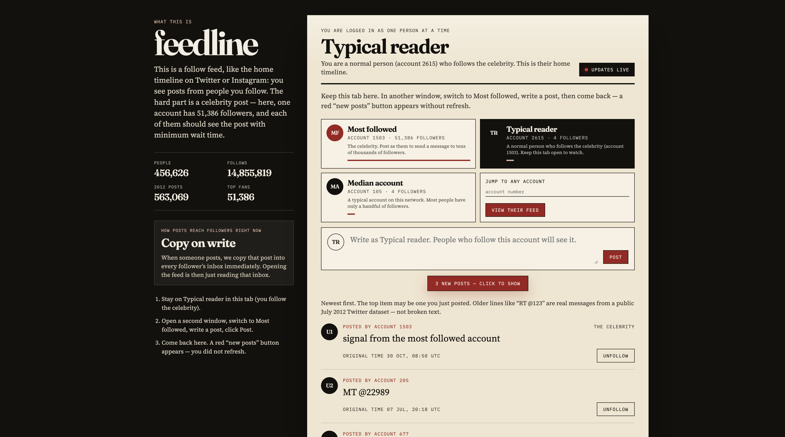
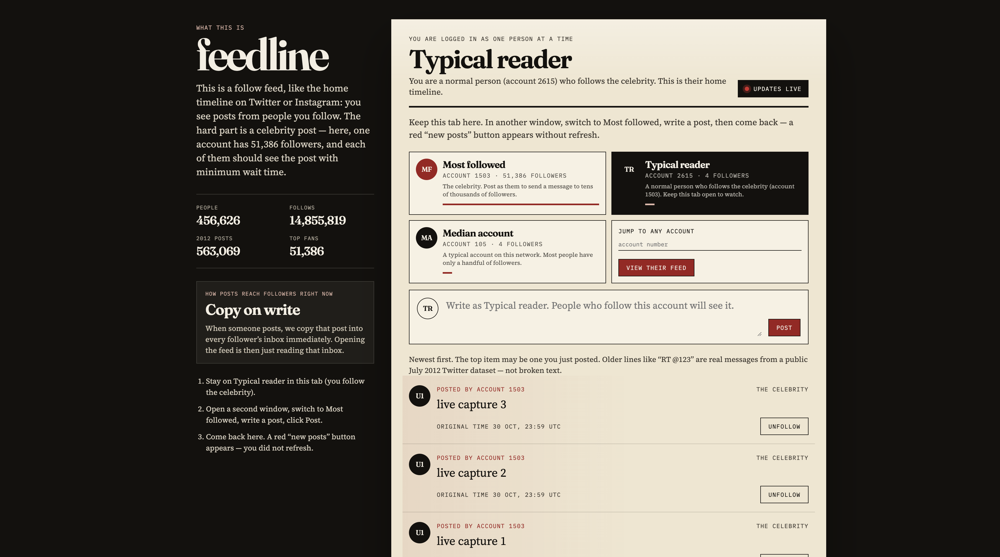

# feedline

A follow feed for the SNAP Higgs Twitter graph. One post is written once. Followers see it either because it was copied into their feed when it was posted (push), because the feed is assembled from the people they follow at read time (pull), or because only ordinary accounts are copied and celebrity posts are merged in at read time (hybrid).

The graph has 456,626 accounts and 14,855,819 follows. The most-followed account has 51,386 followers, so copying every post to every follower is the expensive case. Hybrid exists to skip that copy for accounts at or above a follower threshold.

## Live updates

Open the app as a reader and as an author. A post from someone you follow shows up as a “new posts” pill without a refresh. Clicking the pill inserts those posts at the top of the feed.

Reader 2615 follows account 1503 (51,386 followers). These two captures are from that pair, with the API on push:





## How to run

Postgres on this machine already uses port 5432, so Compose publishes PostgreSQL 16 on **5433**. Redis is on 6379. The Python environment is `~/venvs/feedline` (Python 3.11), not inside this folder.

Download the SNAP Higgs files into `data/` ([graph](https://snap.stanford.edu/data/higgs-twitter.html)):

```bash
mkdir -p data
curl -L -o data/higgs-social_network.edgelist.gz https://snap.stanford.edu/data/higgs-social_network.edgelist.gz
curl -L -o data/higgs-activity_time.txt.gz https://snap.stanford.edu/data/higgs-activity_time.txt.gz
```

```bash
colima start
docker compose up -d
~/venvs/feedline/bin/python backend/load_graph.py data/
~/venvs/feedline/bin/uvicorn backend.api:app --workers 4 --host 127.0.0.1 --port 8000
~/venvs/feedline/bin/python backend/worker.py
```

In another terminal:

```bash
cd frontend && npm install && npm run dev
```

The UI is at http://localhost:5173/. Featured accounts are on the page: 1503 (most followed), 2615 (a typical reader who follows 1503), and 105 (a median account).

To compare strategies, leave the API and worker running and replay the activity file. Speed 60 means one minute of 2012 Twitter time passes in one second. The full activity span is about 168 hours, so one strategy takes about 2.8 hours of wall clock.

```bash
~/venvs/feedline/bin/python backend/flush.py --strategy push --threshold 1000
~/venvs/feedline/bin/python backend/loadtest.py --out results/push.json &
~/venvs/feedline/bin/python backend/replay.py --speed 60 --wait-loadtest
~/venvs/feedline/bin/python backend/verify.py --results results/push.json
```

`scripts/run_all.sh` does that for pull, hybrid at thresholds 1000, 10000, and 100000, then push, all at speed 60. It writes `results/<strategy>.json`. If push falls behind, rerun that one strategy at `--speed 10` and say so next to its row. Do not compare rows that used different speeds.

```bash
~/venvs/feedline/bin/pytest
cd frontend && npm test
```

Tests share the same Postgres database as the replay. Run them when a measurement is not in progress.

## Results

Graph load is recorded in `results/m1.json` and written up in [RESULTS.md](RESULTS.md).

| | |
|---|---|
| Users | 456,626 |
| Follows kept | 14,855,819 (23 self-follows dropped, 0 duplicate edges) |
| Direction | column 1 follows column 2 |
| Max followers | 51,386 (user 1503) |
| p99 followers | 418 |
| Posts in the activity file | 563,069 |
| Busiest 10 minutes | 8,977 posts starting 2012-07-04 05:51:05 UTC |

Timed comparison at speed 60. Full table and notes: [RESULTS.md](RESULTS.md).

| strategy | feed writes | write amp | Redis MB | worst post | backlog peak / drain | read p50/p95/p99 ms | celeb p95 ms | req/s | fresh p50/p99 ms | busy-10min p99 ms | match |
|---|---|---|---|---|---|---|---|---|---|---|---|
| push | 37,759,074 | 67.06 | 580 | 45,221 | 266 / 0.43 s | 6.7/22.5/96.1 | 22.6 | 99.3 | 17.0/606 | 276 | 1000/1000 |
| pull | 0 | 0 | 5.5 | 0 | n/a | 4.7/29.7/98.3 | 29.8 | 99.4 | 3.4/17.3 | 5.2 | 1000/1000 |
| hybrid 1K | 20,251,252 | 35.97 | 333 | 997 | 32 / 0.06 s | 7.1/100/1361 | 102 | 97.1 | 5.1/33.2 | 11.4 | 1000/1000 |
| hybrid 10K | 30,548,796 | 54.25 | 475 | 9,891 | 351 / 0.77 s | 9.0/32.8/337 | 33.5 | 98.2 | 11.3/152 | 52.0 | 1000/1000 |
| hybrid 100K | 37,759,074 | 67.06 | 580 | 45,221 | 230 / 1.84 s | 7.5/24.6/112 | 25.3 | 99.1 | 23.8/658 | 313 | 1000/1000 |

## Design notes

Hybrid is the attempt to keep push’s fast read without paying push’s write on celebrity posts. A push feed is a Redis sorted set per user, trimmed to the newest 800 posts. A pull feed is a Postgres index scan over the accounts you follow. Hybrid copies a post into follower feeds only when the author has fewer followers than a threshold T. At read time it merges that Redis feed with the newest posts from the celebrities you follow.

On this graph, T=1000 is the write win: 1.9× fewer feed copies than push (20.3M vs 37.8M) and 11 ms p99 freshness during the spike, but 95% of feed loads took 100 ms versus 22 ms on push. T=10000 is the better read: 1.2× fewer writes and a 33 ms p95. T=100000 sits above every account (max 51,386), so hybrid copies every post and matches push. T has to sit above the 99th percentile (418) and below the heaviest accounts.

At about ten times the users, push feeds are the thing that stops fitting. This run stored 580 MB for 457K users after trimming to 800 posts. Ten times that is about 6 GB, above the 2.5 GB Redis cap, so feeds would be split across Redis instances by user id (`feed:{user}` already keys that way). Pull’s cost moves to Postgres, where the `(author, created_at, id)` index has to stay selective.

The feed is newest-first because the question being measured is delivery, not ranking. A ranker would change which 50 posts are “correct,” and then push, pull, and hybrid would no longer be comparable.

SSE is enough because the server only needs to tell a connected reader that new posts exist. The browser reconnects with `Last-Event-ID`, and the server replays anything that arrived during the gap. WebSockets would add a second direction this UI does not use.

The two signals that mean the feed is late are the fan-out stream lag (posts accepted but not copied yet) and the 99th percentile feed-read time. Lag climbing during a celebrity post means the worker is behind. Read time climbing on pull or hybrid means the celebrity merge or the index scan is the bottleneck.
